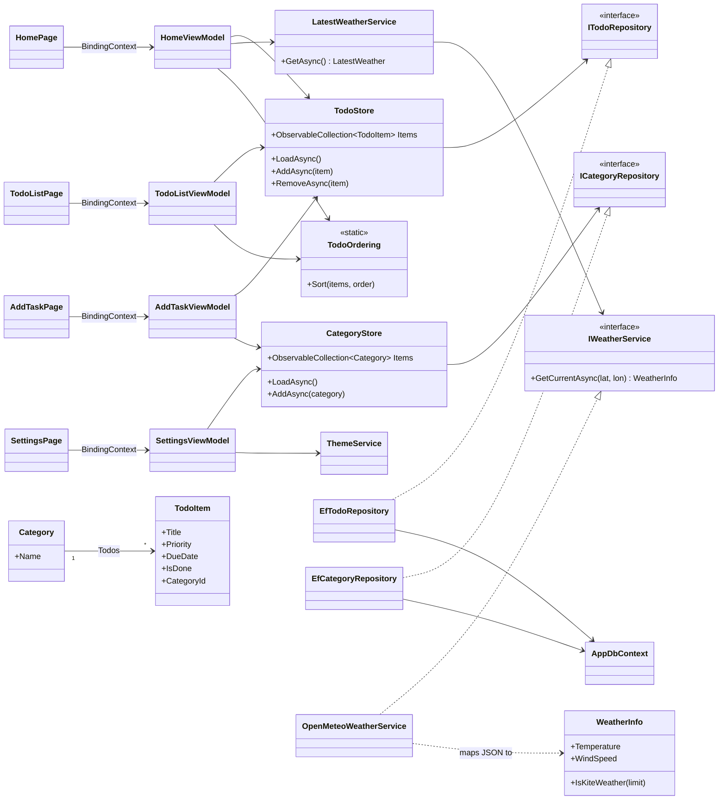

# LifeManagementApp

A .NET MAUI app that combines a to-do list with the weather and tells you when it is kitesurfing weather.
Course work for Client-Side Programming (.NET 9, MAUI 9).

## What the app does

| Tab | Features |
|---|---|
| **Home** | Top 3 unfinished to-dos (highest priority first, then earliest due date). Current temperature and wind speed (m/s) from Open-Meteo for the chosen city. A "🪁 Kitesurf weather!" banner when the wind is **over** the limit (default 5 m/s). Loading indicator, error message when there is no network, Refresh button. |
| **Todo list** | All tasks in a `CollectionView`, sorted by priority or by due date (the choice is remembered). Tick a task as done, delete a task. |
| **Add task** | Title (required, max 40 characters), notes, category, due date, priority 1–5, reminder. An empty title is not accepted. New categories can be added. |
| **Settings** | Theme (System / Light / Dark), default category and priority for new tasks, weather city (Vaasa, Helsinki, Tampere, Turku, Oulu), kitesurf wind limit, reset to defaults. |

Extra features (bonus): settings with `Preferences` (city, wind limit, theme, defaults), the latest weather is cached for offline use, dark theme, categories (1–N relation in the database), marking tasks done and deleting them, xUnit tests.
Not done: an edit page for tasks and a category filter on the to-do list (left in the backlog).

## How to run

Requirements: Windows 10/11, the .NET 9 SDK and the MAUI workload (`dotnet workload install maui`). **Windows is the tested platform.**
The code has no Windows-only APIs and the `INTERNET` permission is declared for Android, but Android was not tested.

Run these in the repository root (the folder with `LifeManagementApp.sln`):

```powershell
# build
dotnet build LifeManagementApp\LifeManagementApp.csproj -f net9.0-windows10.0.19041.0

# run
dotnet run --project LifeManagementApp -f net9.0-windows10.0.19041.0

# unit tests
dotnet test LifeManagementApp.Tests
```

In VS Code you can also select **Local Machine (Windows)** as the .NET MAUI debug target and press F5.

- The weather comes from [Open-Meteo](https://open-meteo.com/). It needs **no API key**; nothing secret is stored in the repository.
- The database `todos.db` is created on the first start in `FileSystem.AppDataDirectory` (on Windows: `%LOCALAPPDATA%\User Name\com.companyname.lifemanagementapp\Data`). The tables are created with `EnsureCreated()`, which does **not** change an existing database. If you ran an older version of the app (before categories were added), delete `todos.db` once.
- The folder `api-tests/` is a [Bruno](https://www.usebruno.com/) collection for trying the Open-Meteo request by hand.

## Structure

```
LifeManagementApp/            the MAUI app
├── Models/                   TodoItem, Category, WeatherInfo, LatestWeather, City, OpenMeteoResponse (JSON DTO)
├── ViewModels/               HomeViewModel, TodoListViewModel, AddTaskViewModel, SettingsViewModel
├── Views/                    HomePage, TodoListPage, AddTaskPage, SettingsPage (XAML)
├── Services/                 weather, repositories, stores, settings keys, ordering
├── Data/                     AppDbContext (EF Core + SQLite)
├── AppShell.xaml             navigation (tabs)
└── MauiProgram.cs            dependency injection registrations
LifeManagementApp.Tests/      xUnit tests for HomeViewModel
Documents/                    assignment and project plan
api-tests/                    Bruno requests
```

## Class diagram



All ViewModels also read settings through `IPreferences` (not drawn, to keep the diagram readable).

How the layers work together:

- **Views** contain only XAML and a tiny code-behind that sets the `BindingContext` and calls the ViewModel in `OnAppearing`. All bindings are compiled (`x:DataType`); `BoolToColorConverter` colours the title counter.
- **ViewModels** use CommunityToolkit.Mvvm (`[ObservableProperty]`, `[RelayCommand]`) and know no UI controls.
- **Services** hold the data access and the logic that is shared: `TodoStore` and `CategoryStore` are the one shared list for all pages, `TodoOrdering` has the ordering rules used by both Home and the Todo list, `LatestWeatherService` falls back to the saved weather when the request fails.
- **Data**: `AppDbContext` has `Todos` and `Categories`. One `Category` has many `TodoItem`s (foreign key `CategoryId`, unique category name, seeded with Study, Home, Health and Work). All database calls are `async`.
- **Weather**: `OpenMeteoWeatherService` calls `v1/forecast?...&wind_speed_unit=ms`, maps the JSON to `WeatherInfo` and turns every failure (no network, timeout, bad answer) into a `WeatherServiceException` with a message for the user.

## Dependency injection lifetimes

All registrations are in `MauiProgram.cs`. Pages, ViewModels and services get what they need through constructor injection.

| Registration | Lifetime | Reason |
|---|---|---|
| `ITodoRepository` → `EfTodoRepository` | Singleton | Holds only the `IDbContextFactory`; each operation creates and disposes its own `AppDbContext`. |
| `TodoStore` | Singleton | The one shared task list: Home, Todo list and Add task must see the same tasks. |
| `ICategoryRepository` → `EfCategoryRepository` | Singleton | Same as the task repository. |
| `CategoryStore` | Singleton | The one shared category list for Add task and Settings. |
| `IPreferences` | Singleton | `Preferences.Default` is one device settings store. |
| `ThemeService` | Singleton | No state of its own. |
| `IWeatherService` → `OpenMeteoWeatherService` | Transient (typed `HttpClient`) | `AddHttpClient` registers it as transient so the factory can manage and reuse the connections. Base address and 10 s timeout are set only here. |
| `LatestWeatherService` | Transient | Uses the transient weather client; a singleton must not hold a transient. |
| ViewModels and pages | Transient | They hold the state of one screen, so each gets its own instance. |

## Tests

`LifeManagementApp.Tests` (xUnit) tests `HomeViewModel` with fakes (`FakePreferences`, `FakeWeatherService`, `InMemoryTodoRepository` with the real `TodoStore`):

- Top 3: only unfinished tasks, priority descending then due date ascending, at most three.
- Kite alert: wind 5.0 gives no alert, 5.1 gives an alert, and a custom limit from Preferences is respected (exactly the limit is not enough).

## Git workflow

New features were defined as GitHub issues, developed on a branch named `N-short-slug` and merged into `main` with a pull request that says `Closes #N`. The project plan is in [Documents/Plans/ProjectPlan.md](Documents/Plans/ProjectPlan.md).

## AI use

I used **GitHub Copilot** (the Copilot agent in VS Code / Copilot CLI) in this project:

- The in-class tasks (issues #1–#19: the first pages, the to-do list, sorting, Settings, the JSON file and the SQLite storage) were built during the course before the AI-assisted project phase. Those commits have no Copilot co-author.
- From the project phase (issues #21–#32) Copilot wrote most of the code from my instructions: the plan in `Documents/Plans/ProjectPlan.md`, the weather service and typed `HttpClient`, the Home page, the settings for city and wind limit, the weather cache, the Category relation, the dark theme audit, the xUnit tests, and this README. These commits carry a `Co-authored-by: Copilot` line.
- Copilot also helped with the issue, branch and pull request workflow and with fixing build problems.
- I chose the scope (for example, what to leave in the backlog), tested every UI feature myself before it was committed, and merged every pull request myself.
